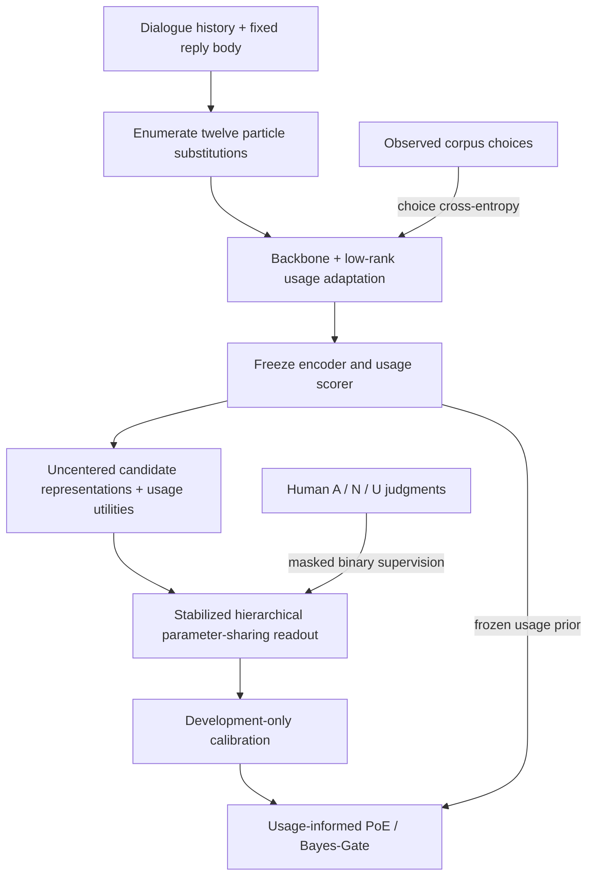

<p align="center"></p>

<p align="center"><b>Counterfactual particle substitution · Stabilized shared readout · Usage-informed selection</b></p>
<p align="center"><a href="docs/usage.md">Run the method</a> · <a href="docs/data-access.md">Get the annotations</a> · <a href="docs/reproduction.md">Reproduction scope</a> · <a href="docs/legacy-usage.md">Historical baselines</a></p>

## One observed ending, several acceptable alternatives

An observed Chinese sentence-final particle reveals a speaker's usage choice. It does not establish that the other endings are unacceptable. **HPSR-SFP** is the code project for a **Counterfactual Particle Substitution Framework** that keeps observational usage learning separate from human acceptability judgments. **Stabilized HPSR** denotes its hierarchical parameter-sharing readout.

This project continues the earlier Pragio repository. The current method uses frozen candidate-conditioned representations; the earlier jointly trained two-head implementation remains available as a historical baseline.

## How it works



- **Adapt first, then freeze.** Observed choices adapt the backbone; unchosen candidates are never assigned human negative labels by this objective.
- **Retain raw context baselines.** Candidate-conditioned features remain uncentered within each context. Feature standardization uses training moments only.
- **Share and stabilize.** A shared high-dimensional direction and shrunken candidate residuals combine with regularized biases and optional usage cues.
- **Select with both signals.** Calibrated acceptability combines with the usage prior through fixed PoE and 0.5-gated rules.

## Start here

```bash
python -m pip install -r requirements-hpsr.txt
python -m hpsr_sfp --help
python -m unittest discover -s tests -v
```

The tests use synthetic inputs only; they do not establish model performance or download pretrained models. For full adaptation and inference, obtain a local backbone and reconstruct the licensed source inputs. Follow the [stage-by-stage commands](docs/usage.md).

| Component | Entry point |
| :--- | :--- |
| Candidate-conditioned encoder and LoRA | [encoder.py](hpsr_sfp/encoder.py) |
| Stabilized HPSR and shrinkage calibration | [hierarchical.py](hpsr_sfp/hierarchical.py) |
| Development-fold selection | [selection.py](hpsr_sfp/selection.py) |
| Raw, centered and scalar readout controls | [readouts.py](hpsr_sfp/readouts.py) |
| Paired bootstrap, randomization and Holm | [statistics.py](hpsr_sfp/statistics.py) |
| Recorded current-method settings | [configs](configs/hpsr_qwen25_15b.json) / [RoBERTa](configs/hpsr_roberta_wwm.json) |
| Historical two-head / AN-LS / EPR / CRISP baselines | [legacy usage](docs/legacy-usage.md) |

## Annotations and release boundaries

The repository includes **498 final annotated contexts** as text-free IDs with twelve A/N/U judgments each: **48 training, 50 development, 200 Test-Initial and 200 Test-Refined**. It also supplies fixed LCCC indices and a source reconstruction script. `first_test.json` maps to **Test-Initial**; `confirmation.json` maps to **Test-Refined**. Source dialogue must be obtained separately under its original terms.

**U means unresolved**, not negative. The two in-domain test partitions retain their distinct annotation guidance. They are not interchangeable repetitions. See [annotation guidance](docs/annotation-guidelines.md).

NaturalConv-derived X100 record-level materials are not distributed. Paper files, experimental result tables, predictions, trained weights and fitted readout/calibration parameters are also excluded. No complete-experiment-archive or turnkey numerical-reproduction claim is made. See [data access](docs/data-access.md), [reproduction scope](docs/reproduction.md), and [research-use notice](NOTICE.md).
